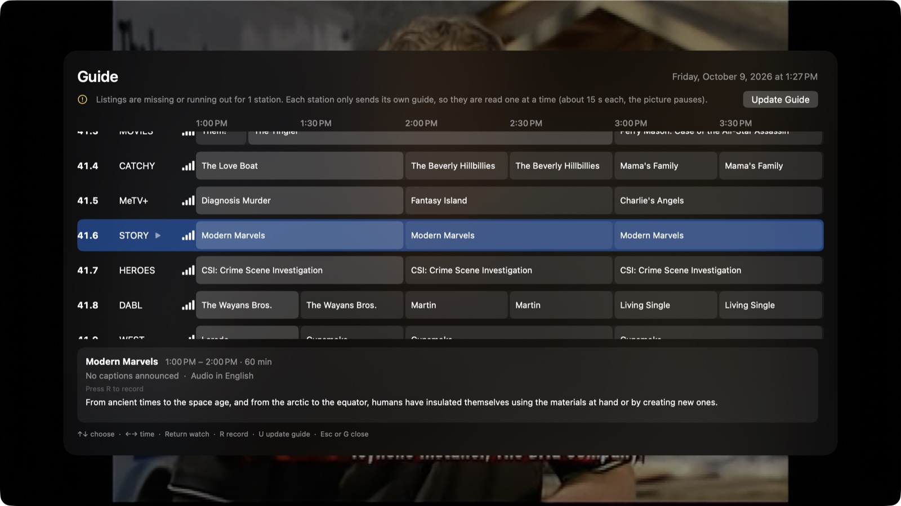
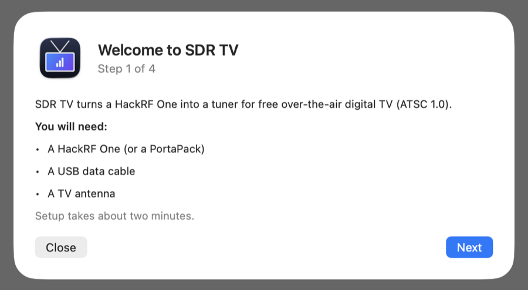
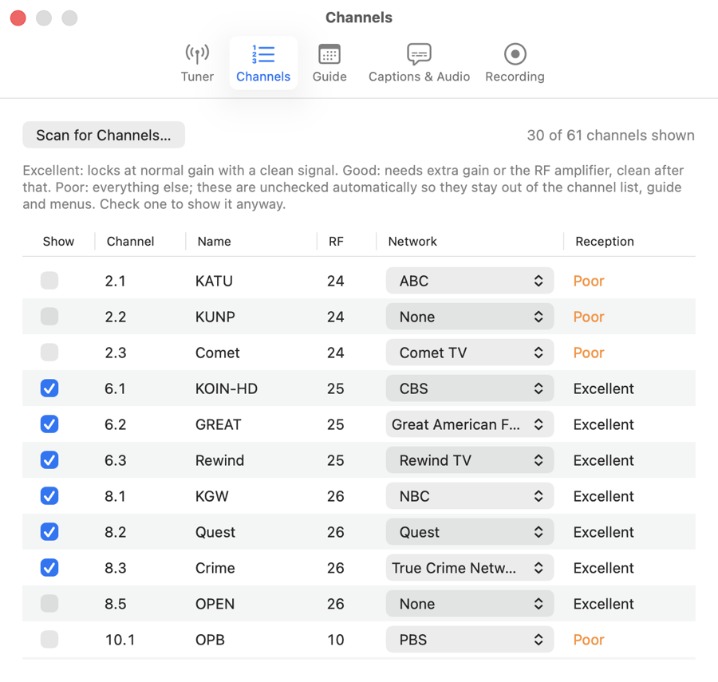

# SDR TV

**Version 0.5.1, alpha.** Expect rough edges; please report issues.

Free over-the-air digital TV (ATSC 1.0) on a Mac with a HackRF One.

macOS only for now. Windows and Linux versions are planned, but not yet available.



## Features

- One-minute channel scan, sorted by reception
- Fast channel changes
- MPEG-2, H.264 and HEVC video; AC-3, AAC and MPEG audio
- Sharper standard definition (Apple super-resolution, macOS 26)
- Closed captions (CEA-608/708), audio languages, audio description
- Program guide, from the broadcast and online sources
- Recording, now or scheduled
- Robust reception: multipath equalizer, automatic gain and recovery

<p>
  
  
</p>

## Requirements

- A Mac with Apple Silicon, running macOS 14 Sonoma or later (macOS 26 for the standard-definition
  enhancement).
- A [HackRF One](https://greatscottgadgets.com/hackrf/one/), connected by USB.
- An antenna for the TV bands. A telescoping whip on the HackRF's SMA connector works for strong
  stations; a proper TV antenna does much better. US TV is horizontally polarized, so turning a
  whip horizontal often helps a lot.
- Stations broadcasting ATSC 1.0. ATSC 3.0 (NextGen TV) is not supported.

## Install

1. Download `SDR-TV-<version>-macOS-arm64.dmg` from the Releases page, open it, and drag
   **SDR TV** to Applications.
2. The app is not notarized, so the first time, **right-click it and choose Open**, then confirm.
   Or clear the quarantine flag: `xattr -dr com.apple.quarantine "/Applications/SDR TV.app"`
3. Connect the HackRF and open SDR TV. The first launch walks you through setup and a channel scan.

## Use

| Key | Action |
|---|---|
| Up / Down arrow | Channel up / down (skips channels marked weak) |
| Left / Right arrow | Volume |
| Digits, then Return | Go to a channel (8.1, 81, or 8) |
| L | Previous channel |
| G | Guide (arrows to move, Return to watch, R to record, U to update, Esc to close) |
| I or Return | Channel information |
| C | Next caption setting |
| A | Next audio track |
| M | Mute |
| R | Start or stop recording now |
| Shift-Command-R | Record the program that is on, to its end |
| F | Full screen |
| U | Update the guide from every station (the picture pauses for a minute or two) |
| S | Scan for channels |

Settings (Command-comma):

- **Tuner:** picture enhancement, gain and the RF amplifier.
- **Channels:** show or hide channels, see each one's reception, and set which network it carries
  (used to match online listings).
- **Guide:** online listing sources.
- **Captions & Audio:** caption language and style, audio language and audio description.
- **Recording:** scheduled and finished recordings.

Scheduled recordings need SDR TV to be running; it keeps the Mac awake while recording. With one
tuner it receives one station at a time, though several programs on the same station can be
recorded together.

## Program guide sources

Each station's own broadcast guide always comes first. Where a station sends nothing, SDR TV can
fill in, in this order:

1. [EPGTalk](https://epgtalk.com) listings for your market (on by default), and the national
   schedules of multicast networks such as Grit or Antenna TV.
2. XMLTV files or URLs you import, or [Schedules Direct](https://www.schedulesdirect.org) if you
   subscribe (optional; their terms allow individual use with open-source software).
3. The same network's schedule from a station in your time zone (labeled; local programs differ).
4. [TVmaze](https://www.tvmaze.com) network schedules (data licensed CC BY-SA 4.0).

The guide shows where each listing came from.

## Build from source

Requirements: Xcode command line tools and [Homebrew](https://brew.sh) (for cmake). Without
`build_radio_libs.sh`, `build.sh` falls back to Homebrew's libusb and libhackrf (`brew install hackrf`),
which only run on the macOS they were built for.

```bash
third_party/build_ffmpeg.sh          # a minimal LGPL FFmpeg, built into third_party/ffmpeg-install
third_party/build_radio_libs.sh      # libusb and libhackrf for macOS 14+ (needs cmake: brew install cmake)
macos/build.sh                       # builds macos/build/SDR TV.app and a zip
macos/make_dmg.sh                    # packages the app as a drag-to-Applications disk image
macos/build.sh --install             # runs the tests, then installs to /Applications
```

`tests/run.sh` runs the regression checks: the receiver against recorded signals, the media layer,
captions, the channel list rules and the player. Checks that need a recording in `captures/` are
skipped when it is not there.
`tests/first_run.sh` drives a brand-new install end to end with the HackRF connected (about two
minutes; your own settings are not touched).

## Limitations

- One HackRF receives one station (RF channel) at a time.
- ATSC 3.0 and encrypted services are not supported.
- The app is ad-hoc signed, not notarized.

## License

Copyright (c) 2026 Martin Bogomolni

SDR TV is licensed under the [PolyForm Noncommercial License 1.0.0](https://polyformproject.org/licenses/noncommercial/1.0.0)
(see [LICENSE](LICENSE)). In short:

- You may use, study, change and share it for any **noncommercial** purpose: personal use, hobby
  projects, research, education, and noncommercial organizations.
- **Commercial use is not permitted**, including selling it, using it in a business, or including any
  part of it in commercial software or products. For commercial licensing, contact the author.
- Anyone you share it with, changed or not, must get the license and this notice:
  `Required Notice: Copyright (c) 2026 Martin Bogomolni`

The summary above is for convenience; the license text governs.

The app includes FFmpeg (LGPL 2.1), libhackrf (BSD 3-Clause) and libusb (LGPL 2.1), each under its
own license. See [THIRD_PARTY_NOTICES.md](THIRD_PARTY_NOTICES.md).
